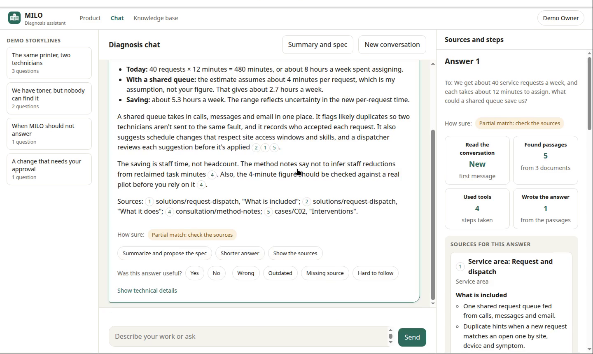
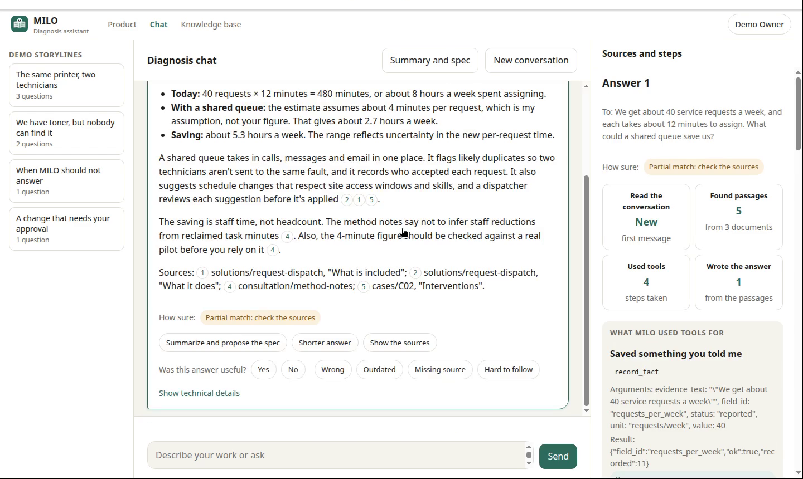
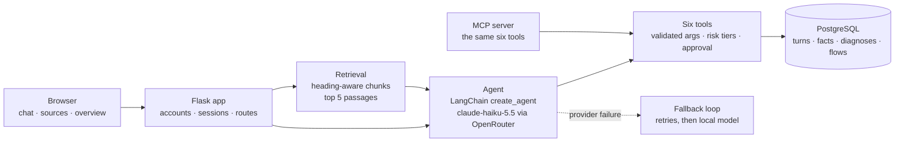

<p align="center">
  
</p>

<h1 align="center">MILO</h1>

<p align="center">
  <b>A diagnosis assistant that shows its work.</b><br/>
  Grounded answers, cited sources, and savings estimates as ranges, for small IT-maintenance and office-equipment businesses.
</p>

<p align="center">
  
  
  
  
  
</p>

---

## Why MILO

Small service businesses lose time in the same places: requests arrive by phone, email and walk-ins, the stock is in a
spreadsheet nobody trusts, and the owner cannot say what an automation would actually save. MILO is a chat that helps
the owner describe the work, finds the matching passages in a knowledge base of past cases and service areas, records
the facts the owner states, and answers with the sources and the steps it took.

It is built to be checked, not just trusted:

- Every claim names its passage. Citations `[n]` open the full source with the passage highlighted in context.
- Savings are computed in code from the recorded facts and shown as a range, with the assumptions listed.
- Destructive actions wait for the owner's approval, and the policy is enforced in code, not in the prompt.
- No prices. The knowledge base and every figure are fictional.

<p align="center">
  
  <br/><sub>An answer with numbered citations, the steps MILO took, and a confidence line.</sub>
</p>

## What it does

| Capability | What the owner sees |
|---|---|
| **Grounded answers** | Numbered citations, a "How sure" line, and an explicit refusal when nothing in the knowledge base matches. |
| **Sources** | A side panel with each passage; a full-document viewer with the passage highlighted in its context. |
| **Tool calls** | Six tools with risk tiers (read, write, destructive). Each step shows its name, arguments, result and policy decision. |
| **Facts and savings** | Facts are recorded with the owner's own words as evidence. Estimates are computed in code, as ranges. |
| **Approval** | A destructive action is paused until the owner approves it. Nothing is changed before that. |
| **Summary and spec** | At the end of a conversation: what was recorded, the estimate per area, what is missing, and the first area to start with. |
| **Accounts and overview** | Sign-up and sign-in, password change, and an owner-only overview of every account's questions, tool use and spend. |
| **Landing page** | A product page with a section index, demo storylines, and a narrated demo video. |

<p align="center">
  
  <br/><sub>The full source opens with the cited passage highlighted, so the surrounding context stays visible.</sub>
</p>

## How it works



One question goes through five stages, and each stage writes a trace line, so the chat can show the path and the overview
can count it:

1. **History**: the last turns of the conversation, read for this owner only.
2. **Retrieval**: the question is embedded and the five nearest passages are numbered.
3. **Agent**: the model answers from the numbered passages, calls tools when needed, and cites the numbers it used.
4. **Tools**: each call is validated, checked against its risk tier, and run in code. Destructive calls wait for approval.
5. **Answer**: the text, the sources, the tool steps, the cost and the trace.

The owner's identity comes from the session, never from a model argument. The same six tools can also be served over
MCP, with the identity taken from a bearer token.

## Quick start

**Requirements:** Python 3.12, [uv](https://docs.astral.sh/uv/). A PostgreSQL database and an OpenRouter key are
needed only for live answers and persistent storage. The offline path needs neither.

```bash
uv sync                 # install the locked dependencies
make check              # lint, format check and the offline test suite (no network, no spend)
make contract           # the course's contract suite against milo.app:build_app
```

Run the web app locally (live model and PostgreSQL), then open http://127.0.0.1:5000:

```bash
make up                 # reads .env, then starts milo.serve on 127.0.0.1:5000
```

Copy `.env.example` to `.env` and fill in the names it lists. Never commit `.env`.

| Variable | Purpose |
|---|---|
| `OPENROUTER_API_KEY` | Key for the chat model and the embeddings (live mode only). |
| `MILO_LIVE` | `1` enables paid model calls. Without it, nothing spends. |
| `MILO_CHAT_MODEL` | Chat model on OpenRouter (default `anthropic/claude-haiku-5.5`). |
| `MILO_STORE` | `memory` (default) or `postgres`. |
| `MILO_DATABASE_URL` | PostgreSQL connection string, used when `MILO_STORE=postgres`. |
| `MILO_SECRET_KEY` | Signs the session cookie. |

## Results at a glance

Numbers come from the files in `evals/results/`. Intervals are 95% bootstrap intervals. The knowledge base and the
questions are fictional, and the sets are small. Read the limits below before quoting any figure.

| Measure | Result | Note |
|---|---|---|
| Retrieval, **test** split (16 answerable) | recall@5 **0.81**, nDCG@5 **0.72** (0.52 to 0.90) | Read once, logged. |
| Retrieval, dev with Gemini embeddings (51) | recall@5 0.75, nDCG@5 0.57 | Offline embeddings reach 0.24 recall, so the embedding model matters most. |
| Hybrid search vs dense (held-out, 32) | nDCG@5 difference −0.03 (−0.16 to 0.07) | Not adopted: the interval contains zero. |
| Tool selection, 20 cases | 0.65 (app loop) vs 0.80 (`create_agent`), one run each | The cases were also used for tuning. |
| Attack harness (10 attacks, 5 benign) | 0 succeeded; 0 false refusals | A small sample: a zero says these attacks failed, not that the system is secure. |
| LLM judge against labels | Not usable | Agreement 0.83, kappa 0.60, lower bound 0.29: below the rule. |
| Answer faithfulness labels (batch 5, 30 answers) | kappa 0.87 (0.67 to 1.00) after the decision rules | The rules were written from this batch's disagreements, so the figure is in-sample. |

## Repository layout

```
src/milo/          application: web routes, agent and loop, retrieval, tools, stores, MCP server, pages
data/              fictional knowledge base (30 documents), gold sets, tool cases, attacks, demo storylines
db/migrations/     PostgreSQL schema (0001 to 0004)
evals/             results, labelling guidelines and labelled batches
scripts/           evaluations, the demo server, the narrated video
tests/             offline tests (about 100), run by make check
docs/
  report/          the project report (HTML)
  lessons/         one note per milestone: what was built and what was decided
  video/           the demo recording and its narration
  images/          screenshots used in this README
```

## Documentation

- [Project report](docs/report/MILO_Project_Report.html): how it works end to end, the milestones, the rubric, the
  limits, and how to reproduce the results.
- [Milestone lessons](docs/lessons/): one note for each of M0 to M7.
- [Demo video](docs/video/demo-recording/): a real-time recording of one session with narration.
- [Labelling guidelines](evals/labeling/GUIDELINES.md): how answers and questions are labelled, and the decision rules.

## Limits

- The evaluation sets are small (16 to 51 answerable questions per split), so the intervals are wide. Differences
  below about 0.2 nDCG are not reliable.
- The self-query filter is adopted on dev only. Its confirmation on the test split is open, because the test split was
  read once already.
- The labels come from language models, not people, and the judge was not validated. See the report for the full list.
- Ten attacks and one model are a small test of security. A zero is not a proof.
- The database connection uses an admin role. A limited role is needed before any real data is stored.

## Licence and data

MIT, see [LICENSE](LICENSE). All businesses, people, documents and figures in this repository are fictional. The demo
recording's narration uses the public-domain LJSpeech voice model (not stored in git).
